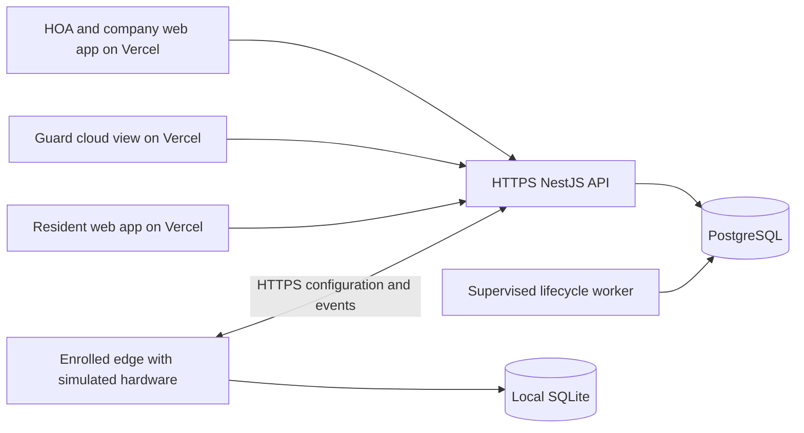

# Next phase: hosted API, database, and authenticated app acceptance

Prepared 27 September 2026. This document records the proposed phase and its implementation status.

**Implementation update (27 September):** Slices 1 and 2 source work is complete. The supervised
worker, container artifact, and deployment-safe frontend URL handling are implemented. The four
hosted-API audit fixes and both follow-up review rounds, including route-based attempt limits and
address-based proxy matching, have regression coverage. Real-mode customer onboarding, which the
staging setup in Slice 3 needs, now exists: a platform administrator adds a village and invites
its first administrator from the management app, with no direct SQL. All 21 PostgreSQL verifier
checks passed locally, including the onboarding suite and two production worker entrypoints
surviving the connection-pool idle period, processing one due move-out at its stored cutoff,
stopping on SIGINT and SIGTERM, and a restarted worker completing new due work without duplicates.
The platform test (70 passed, 2 PostgreSQL-only skips), typecheck, build, format, and protocol
checks pass, and a local headless-browser onboarding run passed at desktop and phone widths.
Docker is unavailable here, so image builds and container runtime acceptance remain open; no
provider deployment or service-restart acceptance has run. Slices 4 through 6 remain open because
the API/database provider and HTTPS API address are not configured, leaving hosted browser
acceptance, enrolled HTTPS edge acceptance, and release/recovery exercise pending. Slice 4's MFA
enrollment screen now exists in all three apps, and the API enforces MFA for platform and village
administrator accounts in production.

**Outcome:** authorized HOA staff, guards, and residents can sign in through the three hosted web
apps, work against a persistent database, and complete the existing household workflows. An
enrolled edge running simulated hardware exchanges scoped configuration and events with the
hosted API over HTTPS, with recorded acknowledgements and recovery evidence.

The existing roadmap names O2, the local guard workflow, as the next feature phase after O1.4
acceptance. Recent frontend deployment exposed an immediate prerequisite: the API still only runs
locally. This plan delivers the cloud foundation and closes the outstanding software acceptance
before advancing to O2. It does not constitute physical-gate commissioning.

## 1. Verified starting point before this implementation

| Area                 | Current evidence and implication                                                                                                                                                                                                                                                       |
| -------------------- | -------------------------------------------------------------------------------------------------------------------------------------------------------------------------------------------------------------------------------------------------------------------------------------- |
| Platform baseline    | Current local HEAD is `747f371`, on `main` tracking `origin/main`.                                                                                                                                                                                                                     |
| Frontend deployments | Previous deployment work created `smartgate-control`, `smartgate-guard`, and `smartgate-resident` on Vercel and verified their sign-in pages. That evidence establishes frontend availability at that time, rather than successful authenticated workflows.                            |
| Environment work     | `.env.example`, the API dev script, and the shared frontend URL configuration are modified locally; `docs/environment.md` is untracked. These changes have not reached the deployed apps. Actual local env files are ignored.                                                          |
| API boundary         | `apps/api/src/app.ts` rejects production mode and non-local request hosts, with a localhost-only origin list. `main.ts` listens on `127.0.0.1`.                                                                                                                                        |
| Database             | External PostgreSQL is supported through `DATABASE_URL`. Otherwise the API uses local PGlite storage. There are 13 migrations, ending with `013_scheduled_move_out_retries.sql`. A hosted database is not confirmed in the deployment record.                                          |
| Scheduled work       | Move-out processing currently starts with the API and repeats through an in-process 15-second timer. Its database work already has retry and concurrency behavior that should be reused.                                                                                               |
| Authentication       | Users, hashed passwords, database-backed sessions, scoped memberships, invitations, MFA, expiry, and revocation exist. Browser session tokens are currently held in memory; refreshing a page requires signing in again.                                                               |
| Household workflows  | O1.4 source work exists: vehicle retirement, scheduled move-out, member changes, vehicle corrections, and paged lifecycle history. The full responsive browser and enrolled-controller acceptance remain open.                                                                         |
| Edge                 | The separate edge repository has enrollment, SQLite persistence, configuration freshness limits, and event replay. Hardware is simulated, local staff authentication is unfinished, and the local HTTP service listens on loopback. Its existing modified test file must be preserved. |

The implementation/status documents contain earlier snapshots that disagree about migrations,
remotes, and validation. Updating those records is part of the first slice. Prior test results
must retain their dates and be distinguished from checks performed for the new release.

## 2. Deployment design

Keep the three frontend projects on Vercel. Use a persistent Node service for the existing
NestJS/Fastify API and a supervised lifecycle worker, with external PostgreSQL. Keep deployment
configuration in `smartgate-platform`; keep the Go controller and SQLite lifecycle in
`smartgate-edge`.

This is a recommendation based on the current periodic worker and runtime shape. Vercel supports
NestJS, but its functions scale with traffic and do not provide an always-running background
server. An API deployment entirely on Vercel would need an explicit function-compatible entrypoint,
connection-pool handling, and a reliable external scheduling path. That can be selected if required;
uploading the current timer-based entrypoint is insufficient evidence of scheduled processing.
[Vercel backend runtime guidance](https://vercel.com/docs/frameworks/backend),
[NestJS on Vercel](https://vercel.com/docs/frameworks/backend/nestjs).

The cloud guard view reads authenticated cloud data and controller heartbeat information. A local
guard station needs a separately reachable, authenticated local edge interface. Its offline login
and shift authority are delivered in O2; an env value pointing at loopback does not create that
connection for a remote browser.

## 3. Implementation order

**Current progress:** slices 1–2 are complete at source level. Slice 3 has its runtime artifact,
worker, and successful local PostgreSQL verification, including actual delayed work, SIGINT and
SIGTERM shutdown, worker restart, and duplicate-audit checks. It still needs container build and
runtime acceptance, provisioned staging and pilot databases with migrations applied by the
migration role, a deployed API and worker with a verified HTTPS readiness endpoint and restart
checks, and the first-operator and staging-account setup. That setup now has a complete in-app
path: the controlled operator command, then the management app's **Villages** screen for the village
and its first administrator, who invites the guard and resident accounts. Slices 4–6 require a
configured staging provider and remain pending.

| Slice | Deliverable                                          | Completion evidence                                                                                             |
| ----- | ---------------------------------------------------- | --------------------------------------------------------------------------------------------------------------- |
| 1     | Reviewed environment and source baseline             | Valid env examples; production builds cannot silently use localhost; existing local files remain ignored.       |
| 2     | Explicit deployment configuration                    | Valid production configuration starts; missing database, enabled demo mode, and invalid origins fail clearly.   |
| 3     | Persistent database, API, and worker                 | Data survives restart; application role cannot modify schema; scheduled work completes without browser traffic. |
| 4     | Three usable hosted apps and O1.4 browser acceptance | Authorized accounts complete role-specific flows on desktop and phone widths.                                   |
| 5     | Enrolled HTTPS edge exchange                         | Scoped configuration acknowledgement, duplicate-event handling, and outage/restart recovery are recorded.       |
| 6     | Recoverable release and handover                     | Readiness, logs, backup restoration, compatible rollback, and an accurate acceptance record are available.      |

### Slice 1: finish environment configuration

Review and retain the existing local environment changes before further edits.

- Convert `.env.example` into actual dotenv syntax: comments and key/value assignments. Move prose,
  fenced examples, and setup commands into `docs/environment.md`.
- Centralize the API URL used by login, invitation, MFA, and dashboard requests. The existing
  `useSession(api)` path should receive the same validated URL as the portal.
- Validate public URLs at build/configuration time. Hosted builds require an explicit HTTPS API
  URL. Keep localhost defaults confined to local development.
- Make the cloud guard view work without a local edge URL. Only a station build with a configured
  local endpoint attempts local status calls; present cloud heartbeat and local status separately.
- Gate simulator controls to the appropriate simulator environment.
- Make local env loading consistent for API development and the migration/operator tools, so
  their working directories do not silently select different databases.
- Update status documents with the current commit, migrations, repositories, and deployment targets.

**Acceptance:** the sample files parse; a frontend build missing its hosted API URL fails with an
actionable configuration error; Git excludes the actual env files; local demo setup is reproducible.

### Slice 2: make API deployment an explicit mode

Create one validated runtime configuration module, used by app startup and the worker.

- Preserve local development and isolated test behavior. Allow production startup only after all
  deployment requirements pass validation.
- Require external PostgreSQL, disabled demo seeding, and schema verification in production.
  Production must not fall back to PGlite or auto-run migrations with the application role.
- Configure the service listen address and validate the public request host/proxy boundary for
  the selected hosting target.
- Replace the fixed local origin list with an exact configured allowlist. Allow only the three
  approved frontend origins and explicitly approved staging origins. Configure the bearer-token
  CORS preflight path without admitting arbitrary Vercel previews.
- Keep the existing scoped, database-backed session scheme. Document the current browser refresh
  behavior rather than introducing token persistence as an incidental deployment change.
- Preserve login lockout, expiry, revocation, MFA replay protections, and controller scoping. Bound
  public login, invitation, setup, and enrollment attempts appropriately for deployment.
- Add separate liveness and readiness checks. Readiness must verify database connectivity and
  required schema; failures return a non-ready response without exposing credentials or records.

**Acceptance:** configuration tests cover valid deployment, absent database, enabled demo mode,
unapproved origins, and unavailable/mismatched schema. Unauthorized role/tenant access remains denied.

### Slice 3: provision and deploy the backend

Prepare a reproducible Node build/runtime artifact and worker entrypoint before provider rollout.

- Build shared workspace packages and the API from the committed lockfile. Include the compiled
  workspace dependencies in the runtime artifact and report its exact Git revision.
- Provision separate staging and pilot databases using provider-supported TLS and connection
  pooling. Keep database and API regions close to reduce request latency.
- Apply migrations `001` through `013` with the migration role. Give the API/worker a separate
  role with data privileges and no schema-changing privileges.
- Validate startup against the recorded migration checksums before the service receives traffic.
- Run the existing due-move-out processor through a supervised worker. Reuse its database claims,
  retry timestamps, and idempotency; ensure it runs without API traffic and does not overlap
  accidentally after scaling or restart.
- Preserve the existing credential cutoff rule: an edge that received the expiry rejects access
  at the cutoff even if cloud housekeeping runs late.
- Bootstrap the first real operator through the controlled setup command, using a password the
  operator enters directly. Create HOA, guard, and resident staging accounts with scoped invitations.
  Require the agreed MFA policy for privileged pilot accounts.

**Acceptance:** API and worker restart without losing records; multiple API instances use the same
database safely; a due schedule executes once across duplicate/restarted worker attempts; the app
role cannot change schema; the deployed service has a verified HTTPS readiness endpoint.

### Slice 4: connect Vercel and close browser acceptance

Configure each frontend project's environment for the correct backend, then rebuild and verify the
resulting deployment. Environment changes affect new deployments, not previously built pages.
[Vercel environment variable behavior](https://vercel.com/docs/environment-variables).

Use these existing projects:

| Project              | Root                | User outcome                                                 |
| -------------------- | ------------------- | ------------------------------------------------------------ |
| `smartgate-control`  | `apps/control-web`  | HOA/company login and authorized management workflows        |
| `smartgate-guard`    | `apps/guard-web`    | Station-scoped cloud view with accurate controller freshness |
| `smartgate-resident` | `apps/resident-web` | Household-scoped vehicles, requests, and decisions           |

Complete the following on a desktop viewport and approximately 390px phone width:

1. First account/invitation, existing-account acceptance, withdrawn-member rejoining, MFA, sign-out,
   session expiry, and switching between authorized organizations/roles.
2. Guard access restricted to assigned stations/lanes; resident access restricted to current
   household occupancy; attempted cross-village access denied by the API.
3. Household roster and primary contact changes; vehicle correction approve/decline; lost-tag
   replacement; vehicle-retirement request/direct HOA retirement.
4. Scheduled move-out create/change/cancel and due cutoff; correct Asia/Manila display with UTC
   storage and stable occupancy attribution.
5. Paged households/history beyond the previous snapshot caps, retained loaded pages during
   refresh, and clean state when the organization changes.
6. Slow service, network interruption, repeated submission, validation errors, and stale-session
   responses. Pending controller delivery must remain distinguishable from acknowledged delivery.

**Acceptance:** real staging accounts complete these workflows through deployed HTTPS pages;
results identify the exact frontend/API commits and tested roles. Demo credentials are not the
production access mechanism.

### Slice 5: prove cloud-to-edge delivery with simulated hardware

Use the real enrollment/authentication path against the staged API and an isolated edge database.

- Create a lane-scoped grant, enroll once over HTTPS, restart the edge, and confirm the persisted
  identity and credentials remain scoped to the intended installation.
- Publish an access change, receive the required configuration version, and record the edge
  acknowledgement in the HOA/resident delivery view.
- Deny reused/expired enrollment grants, foreign-site configuration/events, and revoked controller
  credentials; verify rotation and recovery follow the existing contract.
- Disconnect the cloud, keep local authorization within the approved cache window, queue simulated
  events, and reconnect. Duplicate upload must produce one stored event.
- Rehearse scheduled expiry and cancellation across SQLite restart. Display heartbeat age,
  configuration age, and queued events without equating them with physical passage.

**Acceptance:** capture request IDs, controller ID, protocol/configuration version, acknowledgement,
event UUIDs, restart, outage, and replay results. Record the run as enrolled simulation evidence;
physical equipment still requires its own commissioning.

### Slice 6: release and recovery

- Run the existing format, TypeScript, build, protocol, platform test, PostgreSQL verifier, and
  relevant edge race/regression checks against the candidate source. Add meaningful checks for
  the new runtime configuration, worker restart, and deployed authorization behavior.
- Collect API error/readiness logs, worker heartbeat and oldest due-work age, controller heartbeat,
  configuration acknowledgement delay, and event-queue age. Redact tokens and personal records.
- Rehearse backup and restore into an isolated database with the application role. Verify account,
  occupancy, lifecycle, session, and audit state after restore.
- Record a compatible rollback target and exercise it in staging. Application rollback must respect
  the strict migration-version guard. A restore must also reconcile configuration versions and
  revocations so an older backup does not silently restore access.
- Produce a release record with commits, deployment URLs, schema version, config keys, actual
  acceptance results, rollback steps, and the named person responsible for service recovery.

**Acceptance:** the release can be rebuilt, observed, restored, and rolled back with recorded
evidence. Failed checks or provider setup gaps remain explicit release blockers.

## 4. Environment ownership

| Location                 | Variables/configuration                                                                                                                      | Source of values                                                                |
| ------------------------ | -------------------------------------------------------------------------------------------------------------------------------------------- | ------------------------------------------------------------------------------- |
| API and worker secrets   | `DATABASE_URL`                                                                                                                               | Actual provider connection details, entered in protected service settings       |
| API runtime              | `NODE_ENV=production`, `SMARTGATE_DEMO=false`, `SMARTGATE_SKIP_MIGRATIONS=true`; validated listen/host/origin configuration added in Slice 2 | Reviewed deployment configuration                                               |
| Each Vercel frontend     | `NEXT_PUBLIC_SMARTGATE_API_URL`                                                                                                              | Verified HTTPS API URL for that environment                                     |
| Local station build only | `NEXT_PUBLIC_SMARTGATE_EDGE_URL`                                                                                                             | Reachable station endpoint with the local transport/authentication design       |
| Bootstrap                | Operator password or one-time setup token                                                                                                    | User-entered value through the controlled setup path; never a frontend variable |
| Local development        | Root `.env` and app `.env.local` files                                                                                                       | Ignored local demo configuration                                                |

The existing authentication uses opaque session tokens stored as hashes in PostgreSQL. A JWT
signing secret is not a requirement of the current implementation. Any additional secret introduced
by a later session or deployment design must have a concrete consumer and rotation procedure.

Before provider rollout, establish the API hosting target, PostgreSQL project/region, service owner,
HTTPS API address, and approved origin list. Source configuration, deploy artifacts, and isolated
tests can be prepared before those account details are available. Credentials should be entered
directly in the provider's secret interface rather than included in the plan or repository.

## 5. Phase completion and next roadmap step

This phase is complete when the three hosted apps have working scoped authentication and lifecycle
workflows, PostgreSQL persists records across restarts, scheduled work is supervised, the enrolled
HTTPS simulator exchange is recorded, and release/recovery procedures have been exercised.

The next feature phase is **O2: the local guard workflow**: named shift start/end, offline guard
sign-in and bounded cached permissions, live denial reasons, incident notes, and permissioned
manual assistance with a reason and separate command/outcome audit records. Local guard assets,
authentication, and synchronization need acceptance on the intended station device.

Hardware phases H1–H3 follow the confirmed Hikvision SKU/firmware/protocol, approved wiring,
independent barrier safety arrangements, bench results, and installer/HOA commissioning evidence.

Source roadmap: [detailed implementation plan](detailed-implementation-plan.md),
[O1.4 acceptance plan](o1-4-implementation-plan.md),
[PostgreSQL deployment path](postgresql.md), and [Hikvision pilot requirements](hikvision-pilot.md).
